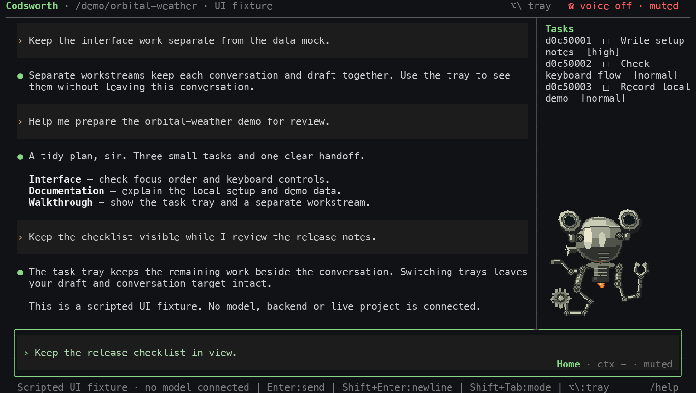
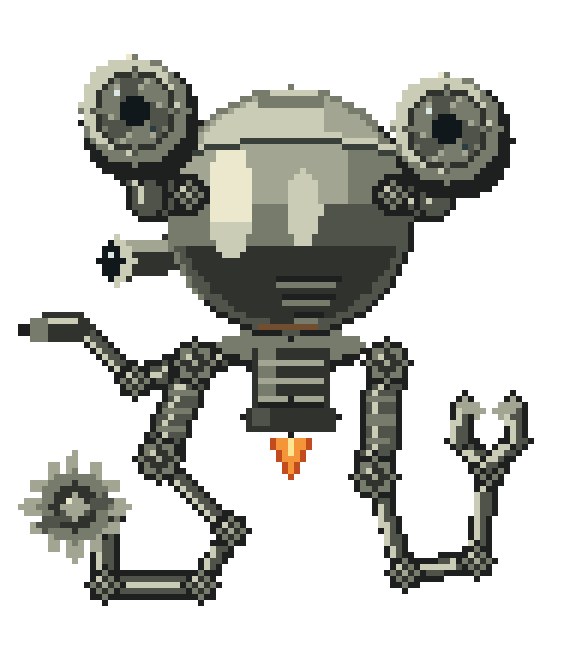

# Codsworth UI

A terminal assistant interface and an expressive pixel character, built by Eric Benson. Streaming conversations, independent workstreams, a compact side tray, keyboard-first interaction, and a shared browser/terminal animation system.



Actual terminal renderer with a scripted fixture conversation; no model or backend connected. [Watch the terminal recording](media/terminal-demo.mp4).

## Try the interface

The browser demos run locally without a model, API key, microphone, or backend:

```sh
python3 -m http.server 8090 --bind 127.0.0.1
```

Open [the local demo index](http://127.0.0.1:8090/), then explore expressions, conversation gestures, and screen interactions. These are real interface components driven by explicit demo events; they do not call an AI model. Optional audio is a file you select locally and is never uploaded.



## Native terminal

Requires Python 3.10 or newer with curses (macOS or Linux). Launch against a compatible Codsworth gateway:

```sh
./scripts/cods --mute --url http://127.0.0.1:18042
# Alternatively: CODS_URL=https://your-gateway.example ./scripts/cods --mute
```

The launcher never opens an SSH tunnel or contacts a preset private host. Without a running gateway the interface opens, and requests report the connection failure. The gateway, model inference, Fleet integration, and issue-tracker credentials are separate services; this repository publishes the client and visual system.

| Control | Action |
| --- | --- |
| Enter | Send the draft |
| Shift+Enter / Alt+Enter | Newline, when supported by the terminal |
| Ctrl+T | Toggle the side tray |
| `/stream new TITLE` | Create a separate workstream |
| `/tasks` | Open local workspace tasks |
| Escape | Interrupt the current operation |
| `/help` | Show available commands |

FFmpeg is optional for speech playback and microphone capture. Hold-Space recording requires a terminal that reports key-release events, such as Ghostty or Kitty, plus a configured transcription service. Voice features are inactive in the browser demos unless you choose an audio file.

## What is here

- `agent/`: the terminal client, keyboard input, rendering, local task/conversation state, and workstreams.
- `glyphs/`: the character generator, 20 expression/activity combinations, browser animator, transitions, and interaction scenes.
- `scripts/`: the portable launcher and reproducible media captures.
- `tests/`: client, renderer, animation, and browser regression tests.
- `media/`: screenshots and silent recordings using fictional demo state.

The animation is joint/pose driven; it is not a crossfade between still images. Browser and terminal rendering share the same geometry and exported animation catalog. Expressions are supplied by the host application, not inferred from audio or sentiment.

## Voice model and training data

The [Codsworth voice project](https://github.com/erictbenson10/codsworth-voice) contains the training recipe, model documentation, and adapter release information. Training audio is excluded here. The dataset’s Hugging Face publication is planned for a later release; no dataset download is advertised as available yet.

## Development

The terminal uses Python’s standard library. The development requirements add
Pillow for glyph generation and export tests, plus FastAPI/httpx for the isolated
integration-reader tests:

```sh
python3 -m venv .venv
.venv/bin/pip install -r requirements-dev.txt
.venv/bin/python -m unittest discover -s tests -v
.venv/bin/python -m unittest discover -s agent -p 'test_*.py' -v
node --test tests/*.test.cjs
```

Browser checks use Playwright and an installed Chromium. Their fixtures synthesize a tone for testing audio events; no training recordings are included. See [publication notes](docs/publication.md) for the export boundary, provenance, and media capture method.

```sh
npm install --no-save --no-package-lock playwright-core
export CODS_BROWSER_PATH=/path/to/chromium
node tests/preview.browser.cjs
node tests/conversation.browser.cjs
node tests/transitions.browser.cjs
node tests/actions.browser.cjs
```

Media captures use Pillow, Python Playwright with Chromium, and FFmpeg:

```sh
.venv/bin/pip install playwright
.venv/bin/python -m playwright install chromium
.venv/bin/python scripts/capture_terminal.py
.venv/bin/python scripts/capture_media.py
```

See [capture provenance](media/provenance.json) for the source checksums and exact methods. The browser recordings show the existing scripted controls, without a model or audio.
